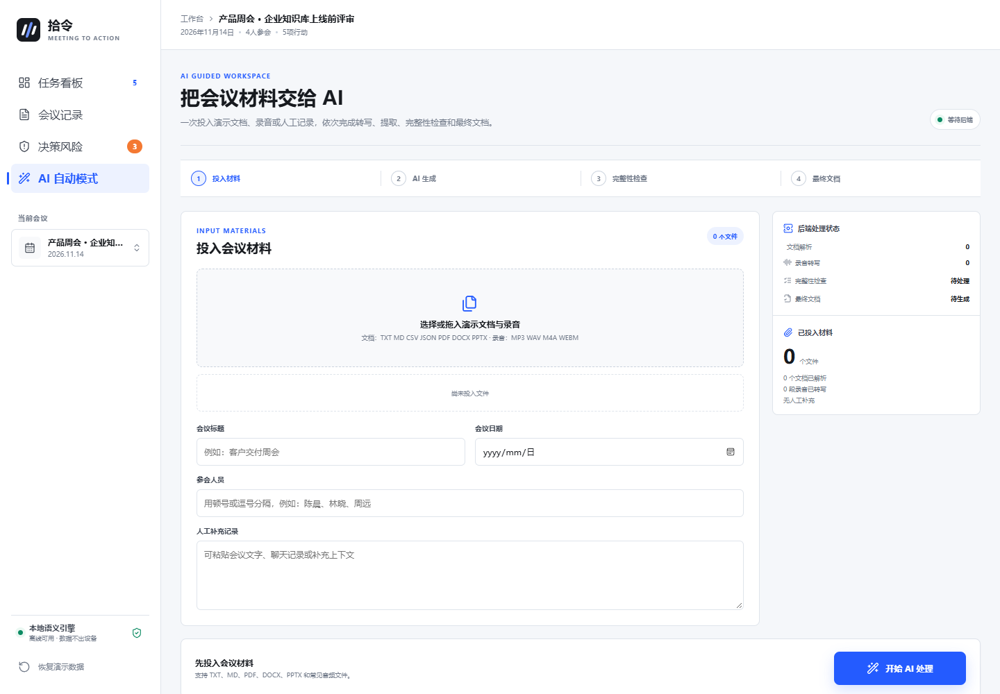
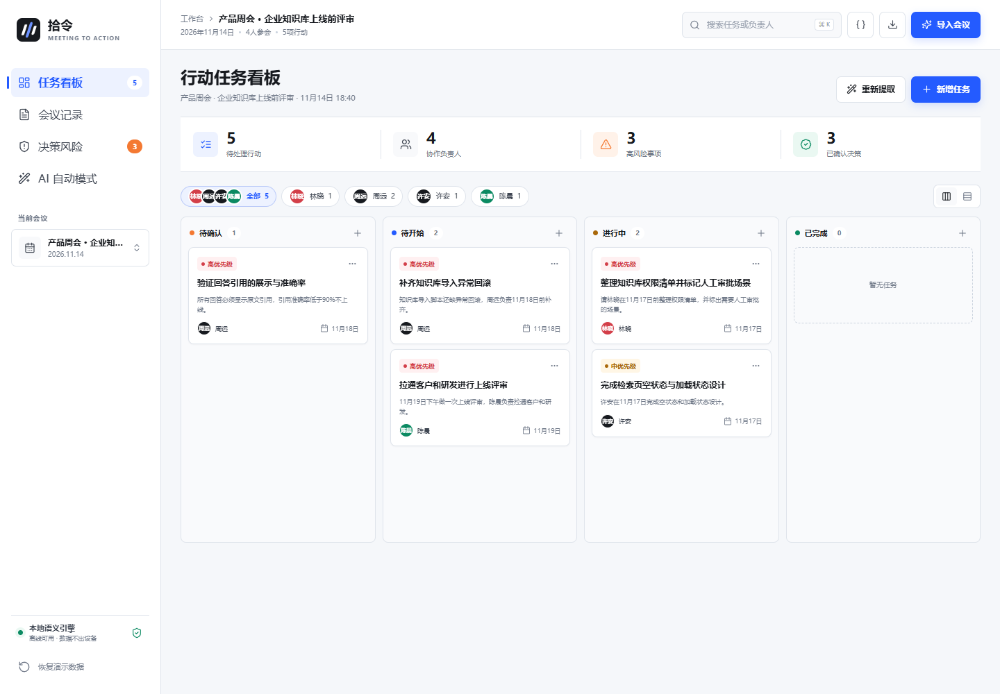

# 拾令 Meeting to Action

面向 AI+办公赛道的会议行动闭环 Demo。上传文档、录音或会议文字后，一键完成材料解析、录音转写、行动项提取、完整性检查和最终文档生成，再把结果送入任务看板跟踪。

<p align="center">
  <strong>AI 自动处理：从会议材料到可执行任务与最终文档</strong>
</p>



<p align="center">
  
</p>

<p>
  
</p>

## 解决的问题

会议通常只留下纪要，没有形成后续执行闭环：

- 行动项散落在聊天记录和纪要里，容易漏掉。
- 负责人、截止时间和验收标准不清晰。
- 决策和风险没有单独记录，后续无法追溯。
- 会开完了，但任务状态、阻塞和延期没人持续跟进。

## AI 自动处理

1. 上传 TXT、MD、CSV、JSON、PDF、DOCX、PPTX 或会议录音。
2. AI 自动模式依次完成文档解析、录音转写、会议提取和完整性检查。
3. 负责人或截止时间缺失时，在同一页面补齐。
4. 生成 Markdown 最终文档，同时写入任务看板和 SQLite。

没有现成材料时，可点击“载入演示文件”。演示材料会保留一个待分配负责人，适合现场补录任意虚构姓名并继续完整流程。

## 当前能力

- 粘贴会议文本，或导入 TXT、MD 文件。
- 本地提取行动项、负责人、截止时间、决策和风险。
- 四列任务看板：待确认、待开始、进行中、已完成。
- 拖拽任务改变状态。
- 新增、编辑、删除任务。
- 按负责人筛选，按标题和备注搜索。
- 将决策或风险一键转为待确认任务。
- 导出 Markdown 会议报告和 JSON 数据。
- 使用浏览器本地存储保留演示进度。
- 支持离线单机运行，原文无需上传；配置外部模型后，会议内容会发送给模型服务。
- HTTP 服务模式下自动连接 Python 后端，使用 SQLite 持久化。
- 后端保留会议历史，支持切换旧会议和新建会议。
- 任务详情支持评论；后端提供活动记录、负责人负载分析、逾期统计和服务端搜索。
- 支持可选 OpenAI Chat Completions 兼容模型，提取失败时自动回退本地规则。
- AI 自动模式：单按钮引导完成材料上传、录音转写、任务生成、完整性检查和最终文档。
- 支持 TXT、MD、CSV、JSON、PDF、DOCX、PPTX 会议材料解析。
- 支持会议录音转写和说话人分离（需要 `OPENAI_API_KEY`）。
- 自动检查会议元数据和任务负责人、截止时间等缺失项。
- 生成 Markdown 最终会议文档。

## 启动

### 离线单机模式

直接打开 `index.html`，或双击 `start_demo.bat`。此模式不依赖后端，数据保存在浏览器本地存储。

### 后端模式

双击 `start_server.bat`，然后打开：

```text
http://127.0.0.1:8765
```

后端服务会同时绑定局域网地址。电脑和手机连接同一个 Wi-Fi 或电脑热点后，手机打开启动窗口里显示的 `http://局域网IP:8765` 即可访问。

如果需要通过本地 HTTP 服务演示：

```powershell
python server.py --host 0.0.0.0 --port 8765
```

SQLite 数据文件默认位于 `data/shiling.db`。需要隔离测试、演示或部署数据时，可通过 `SHILING_DATABASE_PATH` 指定其他路径。

### 一键验收

双击桌面的“拾令验收”快捷方式，或运行 `start_acceptance.bat`。脚本会自动：

- 检查 8765 端口。
- 后端未运行时自动启动。
- 输出电脑和手机访问地址。
- 用默认浏览器打开验收页面。

### 公网临时访问

双击桌面“拾令公网验收”，或运行 `start_public.bat`。

脚本会：

- 在 `8766` 启动带访问码保护的公网实例。
- 建立 localhost.run SSH 隧道。
- 输出公网地址和带访问码的完整链接。

公网实例和本机验收入口使用同一个 SQLite 数据文件。未带访问码的请求会返回 401。临时隧道依赖当前电脑持续开机、联网，以及 SSH 隧道进程保持运行；域名变化时重新运行 `start_public.bat` 即可。

免费隧道可能出现服务商提示页。点击继续后输入访问码即可进入。公开链接仅用于临时验收，不建议长期作为正式生产地址。

## 后端接口

| 方法 | 路径 | 用途 |
| --- | --- | --- |
| GET | `/api/health` | 健康检查 |
| GET | `/api/state` | 获取当前会议、任务、决策和风险 |
| GET | `/api/meetings` | 获取会议历史 |
| GET | `/api/meetings/completeness` | 检查当前会议完整性 |
| GET | `/api/meetings/final-document` | 生成最终会议文档 |
| GET | `/api/demo/auto-material` | 获取 AI 自动模式演示文件 |
| GET | `/api/analytics` | 获取任务、负责人、逾期和风险统计 |
| GET | `/api/activity?limit=50` | 获取审计日志 |
| GET | `/api/search?q=知识库` | 服务端搜索任务、决策和风险 |
| POST | `/api/meetings/extract` | 提取会议并写入数据库 |
| POST | `/api/materials/extract` | 解析上传的演示文档 |
| POST | `/api/audio/transcribe` | 转写会议录音 |
| POST | `/api/meetings/compose` | 合成文档与录音并生成会议 |
| POST | `/api/meetings/{id}/activate` | 切换当前会议 |
| PUT | `/api/meetings/current` | 补充会议标题、日期和参会人 |
| POST | `/api/tasks` | 新建任务 |
| GET | `/api/tasks/{id}/comments` | 获取任务评论 |
| POST | `/api/tasks/{id}/comments` | 新增任务评论 |
| PUT | `/api/tasks/{id}` | 更新任务 |
| DELETE | `/api/tasks/{id}` | 删除任务 |
| POST | `/api/reset` | 恢复演示数据 |
| GET | `/api/export/json` | 导出当前数据 |

统计、活动记录、搜索和 JSON 导出接口均支持可选的 `meetingId` 查询参数，例如 `/api/analytics?meetingId=会议ID`；不指定时使用服务器的默认会议。任务评论在后端模式下可从任务详情查看和添加。

## 演示流程

1. 打开任务看板，展示行动项、负责人、截止时间和风险指标。
2. 点击“导入会议”，选择“载入示例会议”。
3. 点击“开始提取”，展示本地语义提取过程。
4. 在任务看板中拖拽任务到“进行中”或“已完成”。
5. 打开任务详情，调整负责人和截止时间。
6. 进入“决策风险”，把一条风险转为任务。
7. 导出 Markdown 会议报告。

## 验证

```powershell
D:\Python\python.exe tests\smoke_test.py
D:\Python\python.exe tests\backend_core_test.py
D:\Python\python.exe tests\backend_api_test.py
D:\Python\python.exe tests\test_backend_regression.py
D:\Python\python.exe tests\test_backend_http.py
D:\Python\python.exe tests\visual_check.py
D:\Python\python.exe tests\backend_ui_test.py
D:\Python\python.exe tests\standalone_check.py
D:\Python\python.exe tests\backend_materials_test.py
D:\Python\python.exe tests\auto_mode_test.py
D:\Python\python.exe tests\auto_missing_test.py
D:\Python\python.exe tests\auto_demo_test.py
```

`smoke_test.py` 覆盖搜索、负责人筛选、编辑、新建、拖拽、风险转任务和报告导出。

`backend_core_test.py` 覆盖语义提取、SQLite 初始化和任务增删改。

`visual_check.py` 在桌面和手机宽度下检查页面、控制台错误、截图和横向溢出。

`backend_ui_test.py` 验证前端连接后端、会议提取、SQLite 持久化和任务更新。

`standalone_check.py` 验证单文件离线版在手机宽度下可运行。

`backend_materials_test.py` 验证 PDF/DOCX/PPTX 等材料处理和最终文档结构。

`auto_mode_test.py` 验证单按钮自动模式从材料上传到最终文档生成。

`auto_missing_test.py` 验证缺失负责人、截止时间等字段的补齐流程。

`auto_demo_test.py` 验证一键载入演示文件、补录虚构负责人和生成最终文档。

浏览器测试需要安装 Playwright；Windows 上使用已安装的 Microsoft Edge。Linux 可运行 `python -m playwright install chromium` 安装测试浏览器。GitHub Actions 会运行核心、接口和主要浏览器测试。

## 架构

```text
浏览器
  -> 在线模式：`/api/*` -> Python HTTP API -> SQLite
  -> 离线模式：本地语义提取 -> localStorage
```

在线模式优先使用后端数据。每个浏览器独立记住所选会议；保存失败时修改仅保存在本机，不会自动同步，重新打开时也不会自动覆盖。请及时导出 JSON 备份；要放弃本机未同步修改，可通过“恢复演示数据”确认后创建一份新的演示会议。该操作会保留服务器上的原有会议。离线单机模式的数据仅保存在当前浏览器。

保存失败后也可以通过会议切换入口重新读取服务器数据，确认后将放弃本机未同步修改。多位访客同时编辑同一任务时，系统会检测版本冲突并保留未同步的本机修改供导出；本项目面向学习和演示，不提供完整的多人账号和权限管理。

模型提取请求最长等待 60 秒，超时后请先检查会议列表再重试，因为服务器可能仍在处理。超过 12000 字符的会议使用本地规则处理，避免模型只处理前半段。配置外部模型后，会议内容会发送给该模型服务。

## 可选 LLM 提取

后端默认使用本地语义规则。设置以下环境变量后，会优先调用兼容 OpenAI Chat Completions 的模型；调用失败或返回格式无效时自动回退本地规则：

```text
SHILING_LLM_BASE_URL=https://your-provider.example/v1
SHILING_LLM_MODEL=your-model
SHILING_LLM_API_KEY=your-api-key
```

## 录音转写

有 `OPENAI_API_KEY` 时，后端优先使用 OpenAI Audio API，默认使用 `gpt-4o-transcribe-diarize` 并生成说话人分段。

```text
OPENAI_API_KEY=your-api-key
OPENAI_TRANSCRIBE_MODEL=gpt-4o-transcribe-diarize
```

没有配置 Key 时，系统会在 AI 自动模式中明确提示，不会静默丢弃录音。

没有 Key 时，后端会自动使用本机 `faster-whisper`：

```text
SHILING_LOCAL_WHISPER_MODEL=small
SHILING_WHISPER_MODEL_DIR=D:\软件\whisper_models
```

本地模式默认输出时间戳和纯文本转写，不提供说话人分离。模型只需下载一次，音频不会离开本机。

## 路演一句话

拾令不是再做一个会议摘要工具，而是把会议里的“说了什么”变成“谁在什么时候完成什么”，并持续跟踪决策和风险。

## 后续可接入

- 接入兼容 OpenAI Chat Completions 的中文模型，增强长文本和口语会议理解。
- 接入会议录音转写、DOCX 和飞书妙记。
- 对接飞书任务、企业微信、日历和项目管理工具。
- 增加权限、审计日志和企业知识库引用。

## 开源

- License: [MIT](LICENSE)
- 贡献指南：[CONTRIBUTING.md](CONTRIBUTING.md)
- 安全策略：[SECURITY.md](SECURITY.md)
- GitHub 发布说明：[GITHUB_PUBLISH.md](GITHUB_PUBLISH.md)

> GitHub 语言占比不统计内联构建产物 `shiling_mobile.html`，按真实前后端源码计算。
