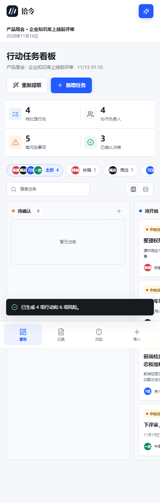

# 拾令 Meeting to Action

面向 AI+办公赛道的会议行动闭环 Demo。把会议原文转换成可追踪的任务、负责人、截止时间、决策和风险，并直接在任务看板中流转。


<p>
  
</p>

## 解决的问题

会议通常只留下纪要，没有形成后续执行闭环：

- 行动项散落在聊天记录和纪要里，容易漏掉。
- 负责人、截止时间和验收标准不清晰。
- 决策和风险没有单独记录，后续无法追溯。
- 会开完了，但任务状态、阻塞和延期没人持续跟进。

## 当前能力

- 粘贴会议文本，或导入 TXT、MD 文件。
- 本地提取行动项、负责人、截止时间、决策和风险。
- 四列任务看板：待确认、待开始、进行中、已完成。
- 拖拽任务改变状态。
- 新增、编辑、删除任务。
- 按负责人筛选，按标题和备注搜索。
- 将决策或风险一键转为待确认任务。
- 导出 Markdown 会议报告和 JSON 数据。
- 使用浏览器本地存储保留演示进度。
- 完全离线运行，原文不上传。
- HTTP 服务模式下自动连接 Python 后端，使用 SQLite 持久化。
- 后端保留会议历史，支持切换旧会议和新建会议。

## 启动

### 离线单机模式

直接打开 `index.html`，或双击 `start_demo.bat`。此模式不依赖后端，数据保存在浏览器本地存储。

### 后端模式

双击 `start_server.bat`，然后打开：

```text
http://127.0.0.1:8765
```

后端服务会同时绑定局域网地址。电脑和手机连接同一个 Wi-Fi 或电脑热点后，手机打开启动窗口里显示的 `http://局域网IP:8765` 即可访问。

如果需要通过本地 HTTP 服务演示：

```powershell
D:\Python\python.exe server.py --host 0.0.0.0 --port 8765
```

SQLite 数据文件位于 `data/shiling.db`。

### 一键验收

双击桌面的“拾令验收”快捷方式，或运行 `start_acceptance.bat`。脚本会自动：

- 检查 8765 端口。
- 后端未运行时自动启动。
- 输出电脑和手机访问地址。
- 用默认浏览器打开验收页面。

### 公网临时访问

双击桌面“拾令公网验收”，或运行 `start_public.bat`。

脚本会：

- 在 `8766` 启动带访问码保护的公网实例。
- 建立 localhost.run SSH 隧道。
- 输出公网地址和带访问码的完整链接。

公网实例和本机验收入口使用同一个 SQLite 数据文件。未带访问码的请求会返回 401。临时隧道依赖当前电脑持续开机、联网，以及 SSH 隧道进程保持运行；域名变化时重新运行 `start_public.bat` 即可。

免费隧道可能出现服务商提示页。点击继续后输入访问码即可进入。公开链接仅用于临时验收，不建议长期作为正式生产地址。

## 后端接口

| 方法 | 路径 | 用途 |
| --- | --- | --- |
| GET | `/api/health` | 健康检查 |
| GET | `/api/state` | 获取当前会议、任务、决策和风险 |
| GET | `/api/meetings` | 获取会议历史 |
| POST | `/api/meetings/extract` | 提取会议并写入数据库 |
| POST | `/api/meetings/{id}/activate` | 切换当前会议 |
| POST | `/api/tasks` | 新建任务 |
| PUT | `/api/tasks/{id}` | 更新任务 |
| DELETE | `/api/tasks/{id}` | 删除任务 |
| POST | `/api/reset` | 恢复演示数据 |
| GET | `/api/export/json` | 导出当前数据 |

## 演示流程

1. 打开任务看板，展示行动项、负责人、截止时间和风险指标。
2. 点击“导入会议”，选择“载入示例会议”。
3. 点击“开始提取”，展示本地语义提取过程。
4. 在任务看板中拖拽任务到“进行中”或“已完成”。
5. 打开任务详情，调整负责人和截止时间。
6. 进入“决策风险”，把一条风险转为任务。
7. 导出 Markdown 会议报告。

## 验证

```powershell
D:\Python\python.exe tests\smoke_test.py
D:\Python\python.exe tests\backend_core_test.py
D:\Python\python.exe tests\visual_check.py
D:\Python\python.exe tests\backend_ui_test.py
D:\Python\python.exe tests\standalone_check.py
```

`smoke_test.py` 覆盖搜索、负责人筛选、编辑、新建、拖拽、风险转任务和报告导出。

`backend_core_test.py` 覆盖语义提取、SQLite 初始化和任务增删改。

`visual_check.py` 在桌面和手机宽度下检查页面、控制台错误、截图和横向溢出。

`backend_ui_test.py` 验证前端连接后端、会议提取、SQLite 持久化和任务更新。

`standalone_check.py` 验证单文件离线版在手机宽度下可运行。

## 架构

```text
浏览器
  -> 在线模式：`/api/*` -> Python HTTP API -> SQLite
  -> 离线模式：本地语义提取 -> localStorage
```

在线模式优先使用后端数据；如果后端断开，前端自动退回本机存储，保留演示能力。

## 路演一句话

拾令不是再做一个会议摘要工具，而是把会议里的“说了什么”变成“谁在什么时候完成什么”，并持续跟踪决策和风险。

## 后续可接入

- 接入兼容 OpenAI Chat Completions 的中文模型，增强长文本和口语会议理解。
- 接入会议录音转写、DOCX 和飞书妙记。
- 对接飞书任务、企业微信、日历和项目管理工具。
- 增加权限、审计日志和企业知识库引用。

## 开源

- License: [MIT](LICENSE)
- 贡献指南：[CONTRIBUTING.md](CONTRIBUTING.md)
- 安全策略：[SECURITY.md](SECURITY.md)
- GitHub 发布说明：[GITHUB_PUBLISH.md](GITHUB_PUBLISH.md)
